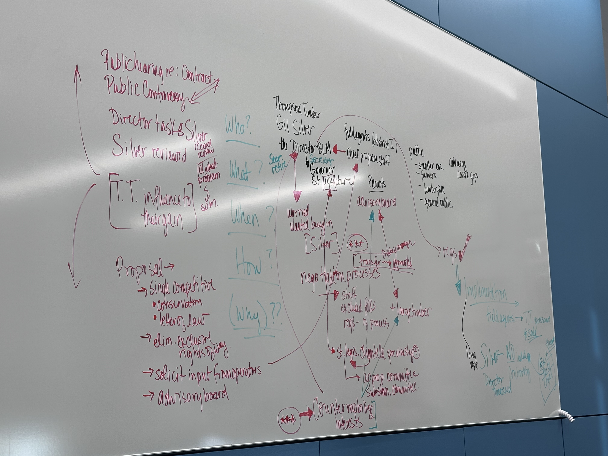

```{r setup, include = FALSE, message=FALSE, results=FALSE, echo = FALSE}
# R libraries
# data manipulation
library(tidyverse)
library(dplyr)
library(tidyr)
library(haven)
library(readr)
library(caret)
library(modelr)
library(broom)
library(ggplot2)
library(plotly)
library(png)
library(openxlsx) 
library(kableExtra)
library(patchwork)
library(texreg)
library(estimatr)
library(MASS) 
library(Matrix)
library(sandwich)   # vcovHC
library(lmtest)     # coeftest
library(boot)       # bootstrap
library(conflicted)
library(car)
library(cowplot)
library(AER)
library(MatchIt)
library(labelled)

conflict_prefer("filter", "dplyr")
conflict_prefer("select", "dplyr")

# For figures
knitr::opts_chunk$set(
                      fig.width = 9, fig.height = 7, fig.retina = 3,
                      out.width = "100%",
                      cache = FALSE,
                      echo = TRUE,
                      message = FALSE, 
                      warning = FALSE,
                      hiline = TRUE
                      )
options(tinytex.verbose = TRUE)

knitr::knit_hooks$set(plot = function (x, options) {
  float_correct <- function(f, y, opts)  {
    if (is.null(opts$regfloat) || opts$regfloat==FALSE)
      paste0(f(y, opts), "\n\n\\FloatBarrier\n")
    else
      f(y, opts)
  }
  if (!is.null(options$out.width) || !is.null(options$out.height) ||
      !is.null(options$out.extra) || options$fig.align != "default" ||
      !is.null(options$fig.subcap)) {
    if (is.null(options$fig.scap))
      options$fig.scap = NA
    return(float_correct(knitr:::hook_plot_tex, x, options))
  }
  return(float_correct(knitr:::hook_plot_md_base, x, options))
})

```

# Goals for this week's lab notebook

- Think about what parts of the readings make me want to dig into factors affecting bureaucrats' decision-making processes

- Write down what I found from the ProQuest's legislative insights regarding SSA's acts / regulation / court cases that can be co


\bigskip

# Week 5 Reading Notes \& Questions

## Questions \& Pam's plan for the class

- Please be sure to prep the case:  The Silver Affair.  We'll spend some time on it in class...so, you'll need to have read it in advance.
  - This case details program analyst Gil Silver’s attempts to reform the process of allocating government land to timber companies. Silver encounters resistance from entrenched stakeholders who exert significant political influence, and must make several radical decisions to enforce his preferred policy. This case examines the roles of a public servant in terms of its practical and ethical constraints. This case asks students to consider whether Silver acted within his rights as a public servant, and to assess possible different paths and outcomes.

- Be ready to answer, in your own words, in two or three sentences each:

- **Q1**. Where exactly is the line, in this case, between legitimate professional discretion and a civil servant substituting his own policy preferences for the judgment of his politically accountable superior? [do any of this week's readings help you decide...what about previous weeks' readings?]

  - **A1**. Silver remained within legitimate discretion when he gathered evidence, developed alternatives, and implemented the Director-approved rule. His authority became harder to defend when he treated his interpretation of statutory purpose as controlling and mobilized outside pressure instead of seeking a formal ruling on whether the Director's exception was lawful. Simon explains why administrators must supply judgment when information is incomplete, while Kaufman shows why hierarchy is still needed to keep dispersed officials working toward common goals [@simon1965; @kaufman2010forest].

- **Q2**. Was Silver’s final refusal — backed by leaked pressure and a resignation threat — an appropriate tool for a career civil servant to use, or did it cross into something that should worry us even if we agree with the policy outcome?

  - **A2**. Silver was justified in refusing a one-company exception that conflicted with the Bureau's standing policy and in asking the Director to reconsider. However, quietly mobilizing clients and the press to pressure his superior crossed a line because it bypassed internal authority; even with a good outcome, the same method could be used by a civil servant pursuing a weaker cause [@shipman2026; @lynn2015kaufman].

- **Q3** If you were Silver’s peer on the Program Analysis staff watching this unfold in real time, would you have backed him, stayed neutral, or raised concerns internally about his methods? Why?

  - **A3**. I would support Silver's refusal to favor Thompson Timber, but I would raise concerns internally about his methods. I would push for a written order, legal review, and formal escalation before involving outside groups, because those steps would protect the policy without letting one career official build his own political coalition [@kaufman2010forest; @lynn2015kaufman].

- It’s easy to read this case entirely through Silver’s eyes, since the narrative follows him.
  - Before class, try deliberately building the Director’s case: What legitimate pressures is the Director managing that Silver may be underweighting — political survival, the agency’s relationships with the legislature, the practical reality that policy needs some minimal buy- in from the groups it affects? 
  - Is the Director’s original instinct — ”sell this to the field and get real endorsements before I’ll issue it” — a reasonable check on a staff analyst’s judgment, or an abdication of the Director’s own responsibility to decide? 
  - When the Director orders Silver to favor Thompson Timber, is that simply corrupt, or is it a recognizably political judgment (trading a policy commitment for support needed elsewhere) that career staff are not well positioned to override unilaterally?

- Here's the plan for next week's class:

  - 5-6pm Small Groups -- Case analysis

  - 6-7pm Large Discussion -- case and this week's readings

  - 7pm-end Research Report Out -- be ready to show your results for Legislative Insight and statutory reading to find key references to states, tribes, territories, localities; Regulatory Insight trying to find rules from your agency that impact SLTTs; SCOTUS Insight to find if any cases impact federalism concerns.  Some agencies my have rules or litigation that does not have anything to do with federalism or with intergovernmental partnerships...if so, why might that be?  

\bigskip

## In-class - Map out the Silver case

Put a timeline together:

- **Who?**: 

  - Thompson Timber; Gil silver; the Director BLM; Governor; State legislatures
  
  - Field agents (district 1); cheif program staff

  - General public; smaller cops; farmers; labor

  - Advocacy groups

- **What?**

  - Public controversy

  - Director tasks 

  - Sliver reviewed

  - T.T. influence to their gain

  - Proposal $\rightarrow$ single competitive conservation; letter of law $\rightarrow$ eliminate exclusive rights of way $\rightarrow$ solicit input from operators $\rightarrow$ advisory board

  - Bring the proposal to the chief program staff $\rightarrow$ the director BLM $\rightarrow$ worried about Silver $\rightarrow$ negotiation process $\rightarrow$ staff excluded; transfer $\rightarrow$ promoted

  - Siliver didn't exclude the large compaines... trys to explain that 

- **When?**

- **How?**

- **Why?**

- Q. Counter mobilising interests




\bigskip


## Reading notes

## 1. Administrative behavior and organizations [@simon1965; @simon2015book]

- p. 32: Critical path scheduling vs Rational choice

- Rationality: what makes "rational" choices?

- Powers: rational choice can be distracted from a power hierachy among stakeholders

- Good vs Best solutions: always want best solutions but could end up finding good solutions
  - economic: maximizing 
  - locally optimized: to find the best of the possible solutions 

- Experiments on decision making: I'm honestly not a big fan of "experiments", since it could make it difficult to generalize concepts, but we sometimes need to set up experiments to find mechanisms of decision-making processes

- Processes of persuasion

- The mechanism of evocation: the institutional structure - would that be the strongest factor faciliating or blocking messages produced? what about ideological factors ??

- The structure of decisions: he also mention *The Forest Ranger* - decisions/behavior are influenced by the service. I was wondering street-level bureaucrats are also in this category.

- Bias/belifs: can be introduced even though we don't want to


\bigskip

## 2. [@kaufman2010forest]

- How bureaucratic organizations balance public service values and authoritative experessions of the public will?

- Rangers work in the whole hierarchy system

- Socialization: important in decentralized organizations
  - how similar rangers can form the process even in the different situations 

- Administrative pyramids:
  - political appointess
  - supervisors
  - administrators 


\bigskip

## 3. [@lynn2015kaufman]

- Discrection
  
  - Who's providing the things?

  - Direct governments (they can make stuffs/ buy stuffs/ provide direct services)

  - Street-level bureaucrats: make decisions with clients in line (e.g., teachers, police, social workers)


\bigskip

## 4. The Limits of Public Service Discretion: The Silver Affair [@shipman2026]

### Case overview and key points

- **Policy problem:** California's Bureau of Public Lands allocates state timber through practices that favor large companies. Small operators and farm, labor, and conservation groups argue that large sale blocks, selective access, and exclusive rights-of-way limit competition and conflict with the law's purpose.

- **Evidence:** Silver reviews the hearing record, agency files, and other agencies' practices. He finds that District 1 mainly listens to large timber companies, while competitive sales bring the state about 55 percent more than the appraised price.

- **Policy options:** The Bureau could keep the existing sustained-yield contracts, adopt simple competitive bidding, or use Silver's middle-ground proposal. His proposal combines competitive bidding with conservation controls, removes exclusive rights-of-way, and gives affected groups a place in policy implementation.

- **Recommendation and decision:** Silver recommends the middle-ground option. The Director agrees only after Silver secures support from the existing advisory committee and other field stakeholders.

- **Implementation:** Silver broadens the advisory committee, transfers resistant staff, and develops regulations with limited headquarters involvement. The new system gains acceptance and appears to work.

- **Conflict:** Thompson Timber later demands preferential treatment. The Director, seeking the company's political support for his promotion, orders Silver to make an exception to the new policy.

- **Silver's response and outcome:** Silver refuses, alerts affected groups, and encourages media attention. The pressure leads the Director to withdraw the order and reaffirm the policy; Silver then accepts an overseas assignment.

- **Central accountability question:** The case asks whether Silver protected the law and an approved program or replaced the Director's political judgment with his own. It also asks whether public participation remained a source of accountability once Silver used it as leverage against his superior [@shipman2026].

[Full Case](https://sk-sagepub-com.ezaccess.libraries.psu.edu/cases/the-limits-of-public-service-discretion-the-silver-affair)

The story begins when Gil Silver worked on the Program Analysis staff of a state Bureau of Public Lands. This agency, located in the Department of Natural Resources for the State of California, is responsible for the management of all state owned lands. On timberlands, the agency contracts with private timber companies to harvest the mature stand. Years of extensive overcutting and low conservations practices on their own lands have caused the private companies to rely increasingly on the timber they can purchase from the state. Competition for the right to harvest this timber is very intense among the timber companies in the state.

Silver’s first awareness of a problem came on January 6, 1993, when at a public hearing in Troutville in the Bureau’s District 1, intense opposition was voiced to a proposed sustained yield contract between the Bureau and the Thompson Timber Company. Under the terms of the proposed contract, Thompson would receive the exclusive option to purchase state-owned timber at the appraised price in return for subjecting the time, rate, and manner of cutting its own forestlands to regulation by the state.

Representatives of small and independent lumber operators and of farm, labor, and conservation groups bitterly denounced the Bureau as a pawn of the large State’s timber interests. They elaborated on this theme by pointing out that, in addition to the proposal under consideration, the Bureau had frequently given preference to the big timber companies by: (1) offering such large blocks of timber that only a few companies would have sufficient financial resources to bid on them; (2) laying out the areas to be offered for sale in such a manner that they would be easily accessible to only a few preferred customers; and (3) allowing these preferred customers the right to retain exclusive rights-of-way over governmental lands so that many harvestable timber lands remained inaccessible to anyone else. In view of these circumstances the dissident groups strongly urged that the Bureau move to a policy of simple competitive bidding.

As a consequence of this opposition, Silver was designated to review the record and make recommendations as to how the agency should act upon the original proposal. As usual, the record of the public hearing was referred to the action officers in District 1 for their review and recommendations. Their response discounted the views of the opposition and recommended no change in their recommendations despite the public hearing; the District officers believed that their practices were based on sound conservation theory. If only the big timber companies could operate in accordance with sustained yield principles, then the Bureau was obliged to do business with them regardless of the effects it had on competitors. Additionally these policies gave the Bureau leverage to reform the practices of the private companies. The field officials recommended that the original proposal be endorsed by the Bureau Director and implemented.

To Silver, it was obvious that the field officials were either unable or unwilling to recognize the significance of the differences of opinion, and that their recommendations disregarded a serious unresolved split in public attitudes and the intent of the laws. The field office also overlooked completely the charges of illegal behavior. He believed that unless both sides of the question were carefully considered and weighed one against the other, the agency could readily find itself in an indefensible position. Major litigation had already hurt other states in this area. He was sensitive to the fact that the proposed policy had considerable economic importance to the area and to the people concerned. In his view, the agency could not simply endorse one position at the expense of the other.

---

From Silver’s standpoint, the real difficulty was that no alternative lines of action had yet been posed to moderate the extreme viewpoint expressed in the original proposal. He believed it was necessary to develop and evaluate the whole range of alternatives, so that the Bureau Director had a wider range of choice in his decision. Accordingly, he recommended that the central staff of the agency undertake a comprehensive review of the whole question and develop alternative approaches in a fresh and uncommitted way. This recommendation was accepted by senior managers, and Silver was assigned the task of developing the policy alternatives.

He assumed this responsibility with a sharp appetite for learning the total implications of the field problem. His investigation consumed all of his energies for several months. He reviewed files with great care, analyzed records of the hearing in detail, and interviewed representatives of other agencies. His studies revealed that the original proposal and the positive field recommendation endorsed the positions of one segment of the total local clientele, a group of timber companies rather small in numerical proportion but large in prestige and influence. All other local groups were almost completely ignored and this reflected a long-term pattern that was decreasing the number of smaller firms.

Silver sought a new approach to operating policy, one that would strike a better balance between the extremes of local viewpoints and one which would be fully consistent with the spirit as well as the letter of the statutes under which the program operated. He reasoned that a policy that encouraged competitive bidding could also be advantageous from a conservation standpoint. Experience had taught the Bureau that, on the average, it received about 55 percent more than the appraisal price whenever there was competition for the timber. Since over 70 percent of the saleable timber in the state was state-owned, the value of this stumpage largely determined the value of private stumpage. Under the impact of competition, then, the value of state-owned stumpage—and, eventually, all other stumpage as well—would increase. Consequently the economic margins on all private timber in the state would increase, discouraging wasteful cutting practices and encouraging the development of bi-products from the waste materials incurred in milling. He was less worried about capacity to implement environmental regulations since none of the actors had proven reliable environmental stewards under state policy. This appeared to Silver to be a much more equitable means of reconciling conservation and business values than that embodied in the bureau’s existing policy.

To implement this approach, however, the Bureau could not simply move to a policy of announced competitive bidding; for this would not ensure state control in respect to conservation. Rather, the Bureau would have to eliminate exclusive rights-of-way to Bureau timber. The Bureau also must eliminate discrimination in timber sales by soliciting the views of all timber operators concerning which tracts of land to log and work with a representative advisory board to reconcile these needs with the Bureau’s responsibility for sound land management and maximum revenue.

The approach offered a feasible solution to the problem, so Silver submitted it to the chief of the program analysis staff with a strong recommendation that the field program be reoriented accordingly. After some discussion his chief agreed to take the proposal to the Director. This was done in a meeting at which Silver was also present. The Director, however, hesitated to alter field policy until he had reasonable assurance that local groups would accept the proposal—even though it was clear in Silver’s judgment that the spirit of the law, if not its letter, was being violated under current policies. The Director was not inclined to change operating policy abruptly without some soundings of local attitudes, particularly among those strong groups who would be hurt and would respond by exerting political pressure. He told Silver essentially: If you can sell this idea to the people in the field, to all of the important groups involved and get their endorsements, I will issue the policy.

This reaction put Silver in the position of taking the lead in an effort to negotiate agreement upon a significant change in public policy. He reflected upon whether this was a legitimate activity for a public servant. By this time, however, Silver felt certain moral commitments to the policy that he had developed and proposed. He believed that it was sound, reasonable, and workable. He saw it as a more democratic and open process and thought it could go far toward resolving conflicts among groups in the field and avoid embarrassing the agency. Moreover, the policy was equitable, economically sound, and squared with statutory intent, while expressing the broader policy objectives of the party in power. Consequently, he regarded an attempt to negotiate agreement upon his proposed policy as appropriate to his staff role to the head of the Bureau. He accepted the assignment and proceeded to the field to undertake his task.

When Silver appeared on the scene in the field, he discovered that the District 1 staff and the responsible administrator were strongly committed to the controversial original policy approach and were already administering it, as though authorization were a matter of form. Their local affiliations appeared to be almost wholly with the group that benefited most from this policy, the big prosperous timber interests. Silver viewed the relationship as bordering on collusion. District administrators had little contact and little sympathy with the groups that had expressed strong opposition in the earlier public hearing. They made no effort to involve them in deliberations or consult with them. Also, the staff possessed a strong professional bias toward existing operating methods as the only ones that could be justified by “professional standards.”

Silver decided that he could discharge his responsibilities only if he worked independent of the field staff. He would have to establish his own associations and working relationships all across the spectrum of local policy attitudes. Working particularly with the groups that had expressed opposition in the public hearing, he explored the basis of their resistance and gradually brought them to the viewpoint that his proposal was a reasonable and workable compromise.

He then moved to consult with the key people in the groups that had been benefiting by the existing policy. He found some of these groups bitterly resistant to any change. They regarded their vested interest as representing sound public policy and refused any kind of accommodation to the protesting groups. Silver, however, suspected that some of them might change if they could be persuaded that his proposal was infinitely more acceptable than having the Bureau accept the completely opposite point of view—simple competitive bidding. Accordingly he concentrated upon the people who seemed willing to take a more moderate position and gradually obtained commitments from them that they would be willing to go along with a middle-ground policy.

In the course of these negotiations, he was dealing with a formally constituted advisory committee that had been in existence for years. This advisory committee had been put together primarily by the staff in the field and it represented the viewpoints of groups that benefited most from the existing preferential policy. Its membership did not include representation of the groups that had protested at the public hearing and felt their interests completely ignored by the field staff. For all practical purposes Silver had to obtain the formal endorsement of this particular advisory committee in order to convince the Bureau Director that the new policy was acceptable to the people concerned. The membership of the advisory group might later be broadened, but for the moment Silver had to work with the existing committee.

His approach was to convince the more moderately minded committee members that the newly proposed policy had the advantage of inhabiting a middle ground that would protect against the possibility of an abrupt and extreme policy reversal. He managed to make this point so successfully that a majority of the advisory committee voted to endorse the new policy. With this endorsement in hand, Silver returned to headquarters to place the results of his efforts before the Director. With this assurance that the policy change could be approved without intense political repercussions, the Director approved the policy and it was issued.

---

The implementation of the new program required at least two major efforts in the field. First, the operating staff of the agency at the location had to be brought to understanding and support of the new policy. Then field staff could assume the major role in the design of the reoriented operating program, and its technical skills and insights could be most effectively utilized. After all, the staff could not be expected to implement effectively any program in which it did not believe. Secondly, all of the clientele groups in the field had to be brought into direct participation in the formulation of the regulations under which the new program would operate. Because the advisory committee in District 1 included representation of only one point of view, restructuring was obviously necessary to enable all interested groups to participate in the formulation of the operating regulations.

It became apparent early that the District 1 manager so personally opposed the new policy that he, in effect, was refusing to support implementation. Consequently, there was no alternative but to replace him. He was transferred to headquarters and Silver was transferred to the field to take charge of the development of the new program. When he assumed these responsibilities, he found that the technical people in the office tended to regard their affiliations with other technical people in the forest products industry as their primary basis of loyalty and interest. These “opposite numbers” in the profession were mainly employees of the large timber companies that were opposed to the new policy.

This meant that the professional staff of the agency was reluctant to subscribe to the new operating policy because of a conviction that the approach would be unacceptable to their professional friends outside of the agency. In addition, the field staff hesitated to develop the new channels of communication and negotiation with the newly included clientele groups.

The change in policy required so much of a reorientation of operating relationships that a genuine shift in role was necessary. Understanding that this would be a difficult transition for the field staff, Silver worked hard to educate, persuade and support the staff. Indeed, he had to transfer out several of the more resistant and uncooperative members of the professional staff. Over a period of time many of the administrative “in groups” readjusted their thinking and commitments.

The clientele groups presented another problem. There seemed no alternative to a wholesale reorientation of the advisory committee structure. This involved persuading the underrepresented groups to abandon their hesitant and suspicious attitudes, in order to bring them into a positive and cooperative relationship in the design of the new operation. At the same time, the favored groups on the advisory committee had to be maintained in a cooperative relationship; their understandable suspicion of the newly represented groups had to be smoothed over so that destructive conflict would not stalemate the work of the advisory committee. Altogether, Silver found himself constantly negotiating with both groups and interpreting one side’s position to the other. In this way he tried to pave the way for the kind of general cooperation among clientele that he knew a successful program required.

This effort had to be carried on simultaneously with the drafting of the regulations to put the new policy into effect. The design of the new regulations encountered numerous technical difficulties, which, for the most part, had to be worked out in the field. Silver suspected that, if the Bureau headquarters staff were called into participation and consultation, their ingrained attitudes would make it all the more difficult to refine the technical aspects of the new program. Consequently, he worked to keep all questions in the field with his own staff and made few calls to the headquarters office for advice, consultation, assistance, or approval. In this way, he managed to maintain a relatively free hand in the design of the new regulations.

Ultimately the new regulations took shape. When they were complete and endorsed by the new advisory committee, they were referred to headquarters for final approval. A long period of inaction at headquarters followed. Finally, Silver returned to headquarters to find out what had happened and why approval had not been given. His inquiries revealed that informal influences were being exerted upon the Director to prevent approval of the regulations. These pressures came from a disaffected minority of clientele groups who had lost their preferred status. They had secretly repudiated commitments given in the field committee meetings and were seeking to defeat the new program by producing prolonged stalemate at headquarters. They had as a potent ally the senior state legislator from their area who also served on the key appropriations and substantive committees concerned with the work of the Bureau.

These circumstances posed a difficult choice for Silver. He believed he could not stand idle while the efforts of his staff and the field committee was being blocked. Consequently, he turned his efforts toward the mobilization of pressures that would counteract the influence of the disaffected minority. He made sure that the clientele groups strongly supporting the regulations raised the right questions as to what had happened to the regulations. These groups began to exert pressure in public forums and with their own local and state legislators to demand senior level approval and bypass headquarters. In a relatively short period of time the counter pressures came to a head. The Director was placed in a position where he had to make a choice between acting upon the basis of the field recommendations or refusing to act because of the pressure exerted by the minority clientele group. Under duress, he accepted the field advice and approved the regulations. The program was now ready to get underway.

---

Operations under the new program began. There were difficulties still to be resolved, many of which had been entirely unanticipated in the preparation of the regulations. Silver and his staff adhered to the strategy of keeping all of his operating problems in the field and working them out through the cooperation of the clientele concerned and of his own technical staff. He avoided involving headquarters seeking neither advice nor intervention. The Director was inclined to give Silver a long rope and take his own chances. The apparent headquarters strategy was to maintain a position where accountability for any failure in the field or any necessity for abandoning the new program could fall squarely upon the shoulders of the field staff and Silver. This was fine with Silver.

The development of the new program went fairly well. It had progressed enough to be adjudged successful by virtually all of the groups concerned. Those opposed grudgingly admitted that at least it was effective. Silver had gone to great pains to make sure that the operation of the program was not open to attack on the ground that it was technically weak or that it had failed to abide by the regulations. If any issue was to be raised it would have to be squarely on policy. The technical execution and bidding practices followed the highest professional standards and were quite transparent. A critical incident occurred, however, when circumstances tempted the Director to break his commitment to the new program.

Thompson Timber, a large and powerful company, refused to grant right-of-way privileges across its property to other operators who required it to gain access to government timber lands unless the Bureau agreed to give Thompson preferential treatment in the sale of government timber located adjacent to Thompson holdings in the southern part of the state. At the same time at agency headquarters circumstances arose which appeared to the Director to provide him with a major opportunity to strengthen the position of his Bureau and with it, his personal political prestige. The Secretary of the Department of Natural Resources was about to retire, and the Director of the Bureau of Public Lands was considered his most likely successor.

To capitalize upon this opportunity the Director needed to mobilize his political resources. In doing so he had a choice either of appeasing his potential enemies, who were critics of the new policy, or of building greater strength with his potential supporters in the field, who had favored the new policy. He calculated that his potential friends had no other place to go in attempting to defend their interests and would support him no matter what happened. Accordingly, he turned his attention toward appeasing his potential enemies. He discovered that the price of their support for his promotion was abandonment of the Bureau’s new policy by acceding to Thompson Timber’s request.

Accordingly, the Director withdrew jurisdiction from the field in this case posing a challenge to the new policy. After review of the case at headquarters, he directed Silver to accede to the Thompson request.

This instruction posed a most difficult issue for Silver. In legal terms, he was responsible to his chief for the implementation of agency policy as a whole. However, in this instance, he was ordered to act in contravention of the newly established agency policy, that had been fully vetted, and to abandon all of the commitments made to the supporting groups in the field. This was really a mandatory order to discriminate in one specific case in violation of standing agency policies and agreements.

Silver regarded his agency head as being under a set of pressures that probably could be neutralized by a careful mobilization of counter pressures in the field. Accordingly, he declined to implement the Director’s instructions, pointing out the consequences of taking action and urging that the order be rescinded. While waiting for his Director’s official response, he moved fast to make sure that the groups that would be most injured by departure from standing policy were alerted to the need for protecting their interests, and that newspapers and other media of public information were stimulated to ask the right questions at the right times in the right places. These tactics mobilized pressures counteracting those exerted upon the Director at headquarters. The matter came to a deadlock with the Director failing to change his instructions, the field administrator declining to act, and loudly vocal pressures in the field expressing themselves in support of Silver. When this hit the media, it created a local controversy and became widely known in the capital. It continued long enough to be embarrassing, indeed almost intolerable, to all concerned. Some way out of the embarrassment was necessary. The Director informally threatened to fire Silver, but Silver calmly refused to act. He just sat tight.

At this juncture the Director opened negotiations through a subordinate, asking Silver under what sort of circumstances it would be possible to calm the clientele. Silver responded that the only satisfactory course of action was to rescind the specific instructions ordering him to depart from the newly adopted policy, to reaffirm the new policy, and to assure all concerned that no action in violation of it would be taken. Assurance was also needed he argued, that the advisory committee groups would be consulted with respect to any proposed policy changes of significance. Silver then stated that when these conditions were met, he intended to withdraw to accept an federal oversees assignment. The Director’s office readily agreed to this proposal in its entirely. The Director was fully prepared to back away from his commitment to abandon the policy if he could gain relative peace in the field, and if this one now too powerful field administrator could be acceptably removed from the action scene. This agreement terminated the critical incident. The Director abandoned his action and reaffirmed the new policy. Silver withdrew for his overseas assignment.

**Appendix**

To project generalizations from a single stream of events is always a hazardous business. Nonetheless, the quest for broad insights into administrative behavior in the American public service must begin with the specifics of actual experience. We believe that the Silver case history is useful for such a purpose, and especially so because his conscious and purposeful decisions derived from a set of Administrative principles basic to his role as he perceived it. As a starting point for reflection, it may be useful to state in summary form, and in essentially his terms, the strategic values he set for himself, and the tactical methods he employed. Together they supply the framework of his perception of himself as a public administrator.

These were his major strategic values:

1. The civil servant’s primary loyalty should be to the program and to its objectives as these are expressed in the law and understood by the public groups affected. This is the essence of a basic American political principle—this is a government of law, not of men. If the views of the politically appointed agency head are incompatible with the intent of the law, the civil servant’s responsibility is to uphold the law unless and until it is changed by the process that originally enacted it.

2. The civil servant’s has a responsibility to stimulate and support the operation of responsible government. This is another principle of the American system. Accordingly, the public affected not only should be kept informed, but they should be assisted in knowing and understanding every significant issue affecting the program. Further, they should be assisted in maintaining themselves in a position to exert pressure and influence in their own interest.

3. Whenever the political officeholders act to further the interests of their political power system, and in doing so damage or undermine the integrity of the program and its objectives, the responsibility of the civil servant is to defend the program by all honorable and ethical means available.

4. The protection and development of the program is more important than the personal survival of anyone engaged in administering it. Civil servants are never justified in protecting themselves by bartering away program values and objectives that the publics concerned have a right to expect them to produce.


\newpage

# Research Report - ProQuest Legislative Insight

## Statutory authority: acts, program, and level of government

- I want to focus on how SSA and state Disability Determination Services (DDS) share responsibility for SSDI and SSI disability decisions. 

- The two acts are successive changes to this system: the 1980 amendments strengthened federal oversight, and the 1984 reform revised disability-review standards and compliance procedures.
  - The acts are **the Social Security Disability Amendments of 1980 (P.L. 96-265)** and **the Social Security Disability Benefits Reform Act of 1984 (P.L. 98-460).**
  - My comparison is at the **state level**, initially Massachusetts, New York, and North Carolina. Territorial arrangements would require separate legal and administrative checks before inclusion.
  - My RQ: *How does political alignment between congressional overseers and SSA witnesses shape the analytical information exchanged about state disability determination, and which implementation problems become visible in those hearings?*
  - For Policy Lab 2, I will trace who sets the rules, who implements them, and where federal and state officials disagree. 
  - For the final project, I want to examine how information about those disagreements reaches Congress.

## Legislative Insight: what I found and how I found it

- Starting from last week's SSA/SSDI/SSI search, I narrowed the search to these two public law numbers in Legislative Insight and expanded the USCS, reports, and hearings lists. 

- The saved four-page legislative-history PDFs are finding aids with collapsed "Show more" sections; they do not contain the full reports or hearing transcripts.
  - [P.L. 96-265](https://li-proquest-com.ezaccess.libraries.psu.edu/legislativeinsight/docview?id=PL96-265): H.R. 3236; enacted June 9, 1980; 94 Stat. 441. The expanded record lists 83 publications, including 8 hearing records and 15 reports.
  - [P.L. 98-460](https://li-proquest-com.ezaccess.libraries.psu.edu/legislativeinsight/docview?id=PL98-460): H.R. 3755; enacted October 9, 1984; 98 Stat. 1794. The record lists 79 publications, including 32 hearing records and 7 reports. These are publication counts, not counts of usable witness exchanges.
  - I read the relevant sections in the saved public-law PDFs, keeping the main statutory text separate from marginal citations. The section references below refer to the enacted laws; current Code sections also contain later amendments.

## Case 1: Social Security Disability Amendments of 1980

- What changed? [P.L. 96-265](https://www.govinfo.gov/content/pkg/STATUTE-94/pdf/STATUTE-94-Pg441.pdf) covered work incentives and disability-program accountability. I will concentrate on Sections 304, 311, and 312.
  - Section 304 amended Social Security Act Section 221, **42 U.S.C. § 421**. Participating state agencies made disability determinations under federal regulations and written guidelines. 
    - The Secretary could specify performance standards, reporting requirements, access to state records, and fiscal controls (94 Stat. 453-457).
  - Federal review could change state determinations. If a state substantially failed to comply, or withdrew from performing determinations, the law provided for federal assumption of the function, with procedures protecting affected state employees.
  - Section 311 added periodic continuing disability reviews (CDRs), generally at least once every three years, with a different schedule for disabilities found permanent. Its effective date was January 1, 1982 (94 Stat. 460). A review requirement did not itself establish that benefits should end.
  - Sections 304(g), 304(i), and 312 required reports or plans to Congress concerning ALJ review, possible federal takeover of state functions, and the act's effects. These are specific statutory channels through which administrative information could reach legislators.

- Legislative history to follow next:
  - ProQuest identifies H. Rept. 96-100, S. Rept. 96-408, and conference report H. Rept. 96-944. I will compare their discussion of state administration with enacted Section 304.
  - *Disability Insurance Legislation* (1979), **HRG-1979-WAM-0041**
  - *Administration of the Disability Program in New York and New Jersey, Vol. I* (July 27, 1979), **HRG-1979-WAM-0066**, are relevant hearing leads. Their records are located; the full testimony still needs coding.

## Case 2: Social Security Disability Benefits Reform Act of 1984

- What changed? [P.L. 98-460](https://www.govinfo.gov/content/pkg/STATUTE-98/pdf/STATUTE-98-Pg1794.pdf) revised the standards and procedures used in disability determinations.
  - Section 2 amended **42 U.S.C. § 423(f)** and the SSI disability provisions in **42 U.S.C. § 1382c**. It established medical-improvement requirements for terminating disability benefits, subject to specified exceptions (98 Stat. 1794-1799).
  - Sections 9 and 10 required regulations on consultative examinations and uniform disability standards. These provisions concern how officials obtain and assess evidence across administrative levels (98 Stat. 1804-1805).
  - Section 17 amended **42 U.S.C. § 421(b)** with deadlines for investigating state noncompliance and assuming state functions. However, Section 17(b) specified expiration on December 31, 1987, and restoration of the preceding provisions. I need to follow later amendments before treating these temporary procedures as current authority (98 Stat. 1811-1812).
  - For the statutory map, I will use [Section 221 / 42 U.S.C. § 421](https://www.ssa.gov/OP_Home/ssact/title02/0221.htm) for state disability administration and [Section 1633 / 42 U.S.C. § 1383b](https://www.ssa.gov/OP_Home/ssact/title16b/1633.htm) for SSI's application of the disability-determination framework.

- Did states comply or resist? The clearest initial evidence concerns resistance *before* the 1984 reform. SSA's historical account documents different routes and dates:
  - **Massachusetts:** Governor Dukakis directed the DDS on March 8, 1983, to follow First Circuit standards that state officials understood to require medical improvement. On February 7, 1984, he stopped CDR terminations.
  - **New York:** On July 22, 1983, Commissioner Perales stopped CDR terminations pending a federal medical-improvement standard.
  - **North Carolina:** In early September 1983, Governor Hunt stopped CDR terminations, except where fraud was involved, pending a medical-improvement standard.
  - These examples show resistance to the earlier review regime, not resistance to a law enacted in October 1984. All three are resistance cases; they cannot establish why some states complied. Source: [Collins and Erfle (1985), Appendix C, p. 32](https://www.ssa.gov/policy/docs/ssb/v48n4/v48n4p5.pdf).

- Legislative history to follow next:
  - ProQuest identifies H. Rept. 98-618, S. Rept. 98-466, and conference report H. Rept. 98-1039. Hearing leads include *Social Security Appeals and Case Review Process* (October 23 and 28, 1981), **HRG-1981-WAM-0040**.
  - *Social Security Disability Insurance Program* (August 18, 1982), **HRG-1982-FNS-0043**. 
  - I will check who supplied evidence and whether committee reports used it.

## Regulations: national rules and state implementation

- Which rule applies across states?
  
  - My substantive focus is the medical improvement review standard. The Title II rule appears in [20 C.F.R. § 404.1594](https://www.ssa.gov/OP_Home/cfr20/404/404-1594.htm); the adult SSI counterpart is § 416.994. 
    - These govern continuing-disability decisions, so I will keep CDR outcomes separate from initial application outcomes.
  
  - I followed the link from Legislative Insight to Regulatory Insight and located final rules at **50 FR 50068** and **50 FR 50118**, both December 6, 1985. 
    - The state-compliance history also lists **56 FR 11012** as a final rule and **56 FR 11025** as a proposed rule, both March 14, 1991. 
    - I will read their preambles and authority notes before assigning a particular implementation effect to them.

## Court cases: challenges to federal administration

- [*Bowen v. City of New York*, 476 U.S. 467 (1986)](https://www.govinfo.gov/content/pkg/USREPORTS-476/pdf/USREPORTS-476-467.pdf) concerned an undisclosed policy for evaluating mental disability. 
  - The Court upheld relief allowing claims to be reopened despite timing and exhaustion objections.
  - For my project, this case shows how local/state actors and claimants challenged federal administration. I will use it to examine the disputed policy and the evidence that reached the court.

## Implementation reports: evidence for congressional oversight

- [GAO-07-8 (2006)](https://www.gao.gov/assets/a252272.html) found problems applying the medical-improvement standard consistently, including unclear guidance, missing prior medical evidence, and judgment in assessing improvement. 
  - SSA agreed on refresher training while questioning whether a more precise threshold would be workable.
  - I want to examine how this disagreement about implementation appeared in congressional oversight.

## Intergovernmental relationships: who is involved and how they interact

- Congress delegates authority through the Social Security Act, funds administration, and requests evidence through reports and hearings. 
  - HHS/SSA issued federal standards and monitored state decisions during the two historical episodes; SSA was then within HHS.

- State DDS agencies develop medical evidence and make disability determinations under federal standards. 
  - SSA funds necessary DDS administration, while state organizations manage daily operations and personnel. 
  - Governors and state department heads can also direct their agencies, as the termination suspensions show.

- Medical providers and consultative examiners supply evidence. Claimants and representatives can challenge decisions through administrative appeals and judicial review. 
  - These actors participate in implementation but are not another level of government.

- Federal courts interpret the law and review disputes. A DDS can face tension between SSA instructions, a governor's directive, and the standards a court requires. 
  - The historical question is which authority state officials invoked and how SSA responded.

- Information moves through this arrangement: DDS records and reports support federal monitoring; SSA officials, state administrators, and affected groups can supply evidence to congressional committees. 
  - I will identify the actual witness and venue before claiming that a state's experience reached Congress.

## Connection to Policy Lab 2 and my research design

- For Policy Lab 2, I will compare Massachusetts, New York, and North Carolina's response timelines, legal justifications, and DDS arrangements. 
- I still need the underlying state directives and evidence on implementation after the reform. I will add a documented complying comparison if I want to explain resistance itself.
  - The relationship diagram will show Congress and HHS/SSA setting authority and resources, SSA monitoring DDS decisions, state officials managing implementation, and courts reviewing disputes. Hearing testimony provides a route back to Congress.
  - I want to distinguish deliberate refusal, compliance with a court order, and difficulty meeting standards because of capacity. A high backlog or an unusual allowance rate alone cannot identify resistance or ideology.

- For the broader project, the historical cases explain why national rules can generate different administrative experiences. 

- My empirical starting point is **House disability hearings in 2000-2014**, which overlaps @ban2026's analytical-testimony period, 1997-2014, and [SSA's monthly state-agency workload series](https://www.ssa.gov/disability/data/ssa-sa-mowl.htm), beginning in October 2000 [@ban2026].
  
  - I will first count usable SSA witness-legislator exchanges in the replication data. Agency website statements help find hearings; full transcripts are needed for legislators' questions and witnesses' answers.
  
  - *Political alignment*: begin with the legislator's party relative to the President's, and distinguish political appointees from career witnesses. Agency ideal points from @acs2025 are a possible additional measure after checking SSA coverage and dates. 
    - Neither appointment status nor an agency score establishes an individual witness's beliefs.
  
  - *Information provision*: utilize @ban2026's analytical-content measure where available, then code references to state implementation, medical evidence, workload, delays, and proposed remedies. I will also record the committee, hearing purpose, and questions asked.
  
  - *Implementation*: compare state receipts, pending cases, and determinations; check historical availability before using CDR-specific fields. 
    - Claims transferred between DDSs complicate geographic attribution. Favorable medical determinations are not identical to benefit awards.
  
  - My first test is whether alignment is associated with information exchanged about implementation. If the sample supports it, comparing answers from the same witness in the same hearing would hold that setting constant. 
    - Agency ideology changes much less often, so many exchanges do not create many independent observations of ideological change.
 
  - To study consequences, I will trace whether identified evidence appears in later committee reports, funding decisions, or SSA guidance. Poor performance can itself trigger hearings; a later improvement would not by itself show that testimony caused it.

- My contribution to @ban2026 would be to examine which information about a shared federal-state task reaches congressional deliberation, and whose implementation experience it represents. The final course paper can combine a bounded hearing analysis with the state comparisons and a documented account of subsequent responses. 
  - A causal claim about testimony changing DDS outcomes will require additional evidence and a stronger design.


\newpage
