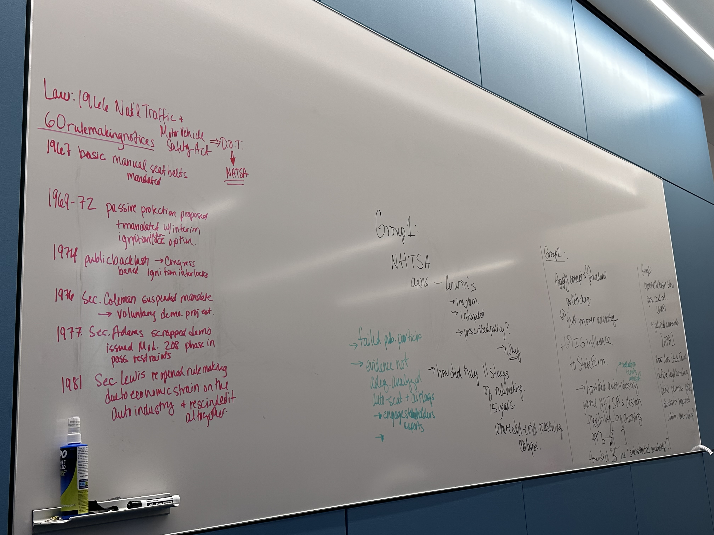

# Goals for this week's lab notebook

- Write down my thoughts on the readings

- Connect learnings from the reading to my research interests

\bigskip

# Week 6 Reading Notes \& Questions

## Pam's plan for the class

Our readings for this week are located in the module:  Executive Politics and Rulemaking.  We chatted during class last week about the use of cases and what you all would like to get from them.  As a result, I changed to a different case (not the shrimp baiting case -- most of it is duplicate work from what we did last week).  
No case already written does what I want it to do for us -- so I had Gemini help me (last week we tried Claude -- it wasn't the best tool!).  That Gemini compiled case is also located in the module.  I recommend doing the Potter and Kerwin readings first and then the case.  
In your lab notebook, include takeaways from Potter's chapters.  Kerwin is harder to summarize, but provides LOTS of useful info.  His space in your notebook likely will be more expansive.  For the case, I recommend reading it through from start to finish pretty quickly.  We will do the activities in class -- be sure you have the material you need to do them (in other words, then go back and re-read, noting or highlighting important info).  
Gemini wasn't perfect, so we'll see how well we stumble through with this version!

Lastly, keep working on Lab 2 research in your groups.  I'll likely have a rubric posted by the end of the week that will help.  You will definitely need to have used Legislative Insight, Regulatory Insight, and Supreme Court Insight to get full points.  You'll also need to add more readings/research to your bibliography.  Depending on how long our case takes, we'll try to touch base on Lab 2 expectations at the end of class.  If not, I'll send out a note with details later.  

- Potter is working on a book about contracting right now

- her grad school friend

- I'm so excited to reread one of my favourite books [@potterbending2019]

## Reading notes

## 1. Rulemaking Chapters 1-2 [@kerwin2019]

### Chapter 1. Rulemaking

- Rulemaking: "rule is the skin of a living policy . . . it hardens an inchoate normative judgment into the frozen form of words. . . . Its issuance marks the transformation of policy from the private wish to public expectation. . . . The framing of a rule is the climactic act of the policy making process.” (p.4)

- The source of rules: agencies
  - rules do not come from the Constitution directly

- Rules vs laws: rules - *interpret* when law and policy are established but face unanticipated/changing circumstances 

- Rules and Congress: rules - *prescribe* when Congress establishes the goals of law/policy 
  - but provides "few" details ... how to be put into operation

- Proposed rules, number of pages (p.16)
  - I read a couple of papers using the page count to measure the ideology of the administration / agency
  - Yes... page counts would matter if a rule contains lots of important factors - but would some of them just be long because it includes lots of tech/medical terms?

### Chapter 2. The Process of Rulemaking

- The substance of rules

- 553 rule making (p.49)

- Information that agencies consider \& provide the public

- Figure 2.2. The Reg map: Informal rulemaking (p.70)

\bigskip

## 2. Bending the Rules Chapters 1-2 [@potterbending2019]

### Chapter 1. The Power of Procedure

- Main research questions
  - 1. What are bureaucrats’ incentives in the rulemaking process? 
  - 2. How do bureaucrats strategically manage the process in light of those incentives? 
  - 3. What are the broader implications of this behavior for democracy and policy making by the bureaucracy?

- Contraception cases
  - how HHS frames their rulemaking proposals matter - more acceptable in the current political disclosure?
  - contraception vs birth control: nuanced differences help shape how the public/political overseers perceive the rule

- Bending the rules:
  - the rules: the procedures associated with the notice-and-comment rulemaking process
  - the comment data is always very interesting, and I wanted to draw out a network of agencies using the comment data to see how different agency interacts to get what they want
  - argument: the rules are adapted "so as to ensure that the proposed rules sponsored by bureaucrats survive to become binding law." (pp.18-19)
  - substantial agency autonomy matters; we can link the logic of procedural politicking to administrative processes that secure preferred outcomes
  - agency focuses: agencies within the executive branch, from 1995 to 2014  
    - independent agencies vs executive branch agencies: fundamentally different when it comes to rulemaking

- 1. The policies created through rulemaking are hard to undo (p.21-22)
  - so even though the previous policy was better than the current one, it's difficult to go back
  - due to not only the rulemaking processes but also external influence \& oversights that affect the rulemaking processes

- 2. The court's rebuff - a subtle difference in the procedures does really matter to manage the process

- 3. The rules make significant/durable policy changes
  - HHS's ability to secure the victory highlights the importance of agencies' strategic behaviour in rulemaking processes

### Chapter 2. The Nuts and Bolts of Notice-and-Comment

- Figure 2.1. Map of the notice-and-comment rulemaking process (p.29)
  - [Rulemaking process](https://www.reginfo.gov/public/reginfo/Regmap/)

- Why agency initiates a rule? 
  - can be driven by overseers, interest groups, or due to regulatory actions that agencies take to write a formal petition
  - Table 2.1. (p.30)

- Table 2.2. Pathways to the regulatory veto (p.41)
  - President vs Congress

- Political oversight
  - OIRA, [The Office of Information and Regulatory Affairs](https://obamawhitehouse.archives.gov/omb/oira)
  - the president: has a direct veto over the creation of each new rule
  - Federal register
  - Congressional oversight: more fragmented than the president oversight
    - tend to learn problematic systems from their various sources: constituents, interest groups, the media, one another, and sometimes the agencies themselves
    - members of Congress (MCs): police patrols vs fire alarm, MCs more rely on outside monitors - fire alarm (p.40)

- How each executive agency perceives political oversight?
  - what creates variations, beside partisanship?
  - would the mechanism be significantly different between exec agencies vs independent agencies?

\newpage

## 3. State Farm Case

### Case overview and key points

- **Policy problem:** Many drivers did not use manual seat belts, even though restraints reduced injuries and deaths. NHTSA used vehicle design as the intervention point and required passive restraints that protected occupants without an extra action.

- **Regulatory history:** Federal Motor Vehicle Safety Standard 208 moved through several administrations and was proposed, delayed, revised, suspended, and reinstated. Manufacturers could comply with airbags or automatic seat belts, which gave them flexibility but made the expected safety benefits less certain.

- **Decision before NHTSA:** The Reagan administration asked whether NHTSA should retain, modify, or rescind the passive-restraint requirement. The agency expected manufacturers to choose detachable automatic belts instead of airbags and worried that drivers would disconnect them.

- **Stakeholders and political pressures:** NHTSA had technical expertise, manufacturers controlled implementation choices, and insurers and consumer groups supplied evidence and litigation pressure. Congress, the President, OIRA, and the courts also had different ways to review or block the rule.

- **Agency action:** NHTSA rescinded the requirement because it expected little safety benefit from detachable automatic belts. The agency did not fully analyze an airbags-only requirement or a modified rule requiring continuous, non-detachable belts.

- **Court decision:** The Supreme Court did not say that NHTSA could never rescind the rule. It held that this rescission was arbitrary and capricious because NHTSA ignored important alternatives and did not connect the evidence in the record to its conclusion.

- **Rulemaking lesson:** Agencies may change policy after a presidential transition, but they still need a reasoned explanation based on the administrative record. This fits Kerwin's description of rules as the step that turns broad statutory goals into operating policy, and Potter's argument that procedure affects whether an agency's policy survives political and judicial review [@kerwin2019; @potterbending2019].

\bigskip

### My recommendation

- **Recommendation:** Modify and retain Standard 208 rather than rescind it. NHTSA should compare airbags, detachable belts, and continuous belts, then adopt the option supported by the strongest safety and implementation evidence.

- **Reasoning:** Rescission gave up the safety objective because one expected form of compliance might perform poorly. A modified rule would address that problem while creating a better record for judicial review.

\bigskip

### Teaching questions

- **Q1. Was NHTSA wrong on the merits or only inadequately explained?**

  - **A1.** The Court mainly found that NHTSA inadequately explained its decision. NHTSA could change policy, but it had to analyze airbags and continuous automatic belts before concluding that rescission was the best option. Potter's regulatory-veto framework helps explain why this weak record made the decision vulnerable in court [@potterbending2019].

- **Q2. How should agencies evaluate uncertainty?**

  - **A2.** Agencies should identify the uncertain assumptions, compare plausible outcomes, and explain how each one affects the policy choice. Here, NHTSA should have estimated belt disconnection under different designs and compared those results with the expected safety benefits and costs of airbags. Kerwin's account of notice-and-comment rulemaking shows why public comments and technical evidence should be used to test those assumptions [@kerwin2019].

- **Q3. When should courts defer to expert agencies?**

  - **A3.** Courts should defer when an agency acts within its statutory authority, considers the important evidence and alternatives, and explains the connection between facts and its decision. Deference is weaker when the agency ignores a major option, contradicts its own record, or uses a political change as a substitute for analysis.

- **Q4. How should Congress balance discretion and accountability?**

  - **A4.** Congress should set the safety goal and require transparent evidence, reporting, and review while leaving technical design choices to NHTSA. Potter's discussion of fragmented congressional oversight suggests that hearings, reports, and fire-alarm monitoring can expose implementation problems without Congress writing the vehicle standard itself [@potterbending2019].

- **Q5. What evidence belongs in the administrative record?**

  - **A5.** The record should include crash and fatality data, seat-belt use and disconnection rates, the effectiveness and cost of each restraint design, manufacturer implementation plans, public comments, and the assumptions behind the agency's estimates. It should also include contrary evidence, feasible alternatives, and the agency's explanation for accepting or rejecting them [@kerwin2019].

\newpage

# In-class Exercises

## Backgrounds

- Seat belts as a public safety policy
  - Seat belts reduce deaths and injuries in crashes, but they only work when people actually use them.

- Targets and their interests:
  - Public: drivers \& riders want safety at a low cost.
  - Manufacturers: care about profits, so they prefer the cheapest way to comply (e.g., detachable automatic belts rather than airbags).

- People don't automatically wear seat belts.
  - Changing this requires cultural and habit changes, which is why NHTSA focused on vehicle design (passive restraints) instead of driver behavior.

- Congress passed a law banning ignition interlocks.
  - For 1974 model-year cars, NHTSA required interlocks that stopped a car from starting unless the belt was buckled. 
  - The public backlash was strong, so Congress overrode the rule by statute in 1974. This is an early example of a congressional veto of an agency rule.

## Franklin D. Roosevelt (FDR)

- History: the New Deal expanded federal power and created many new administrative programs.
  - Completing the Hoover Dam
  - The Public Works Administration (PWA)
  - Construction projects across the states, so people had jobs and didn't starve during the Depression
  - However, these programs required huge spending and broad delegation of power to agencies.

- The Supreme Court started to shrink FDR's initiatives.
  - the court struck down New Deal statutes as unconstitutional delegations of legislative power, because they gave agencies no clear standards.
  - FDR responded with the *court-packing plan*: adding one justice for every sitting justice over age 70 to overcome the 5--4 majority against him among the nine justices.
  - Congress rejected the plan, but two justices shifted their votes, and the Court began upholding New Deal programs. Later vacancies let FDR reshape the Court.

- It was hard to see what each agency was actually doing.
  - FDR created the Attorney General's Committee on Administrative Procedure. 
  - It produced qualitative case studies of how about two dozen agencies actually worked; their reports are still very helpful for understanding early rulemaking.
  - The committee's recommendations became the basis for the Administrative Procedure Act (APA) of 1946.

- The APA was a *deal struck between opposing political forces*.
  - Conservatives: the government overreached; courts and common law should protect private property, individual rights, and economic stability.
  - Liberals (New Dealers): economic elites benefit from an inactive government; we need an active government that can quickly make policy for broader social and public values.
  - The New Dealers mostly won, because the APA's rulemaking requirements were minimal [@kerwin2019, pp. 10--11 and 45--48].

## Congressional Veto

- Legislative veto: from the 1930s, many statutes required agencies to submit rules to Congress, and one or both chambers (or even a committee) could reject them. 
  
- Congressional Review Act (1996): agencies must send final rules to Congress, and a major rule cannot take effect for 60 days, so Congress has time to say "NO."
  - However, a CRA veto needs a joint resolution passed by both chambers and signed by the president, so it is rarely used (only once from 1995--2014).
  - Because the congressional veto is so hard to use, opponents of a rule often go straight to the courts instead.

- Powerful elites can sometimes hold agencies more accountable than the courts do.
  - Across the 11 stages of rulemaking, state agencies and interest groups (lobbyists, non-profit groups, etc.) often have more information and earlier access than the general public, especially before a proposed rule is published.
  - Business and other moneyed interests also submit a much larger share of public comments, so the participation is imbalanced [@potterbending2019, pp. 10 and 33].

## Courts

- Courts look at the particulars of each case:
  - Legality: whether the agency stayed within its statutory authority and followed the required procedures.
  - How the decision was reached: whether the agency considered the relevant factors and reasonable alternatives, and explained the connection between the evidence and its choice (the "hard look").
  - Judicial review is sporadic and reactive, since someone has to sue after a final rule is issued [@potterbending2019, pp. 48--49].

## Politicking

- What tools/tactics do bureaucrats use?
  - Writing the proposal: framing the issue in favorable terms, and making the rule longer or less readable when overseers are hostile.
  - Public consultation: extending or limiting the comment period, and choosing visible outreach (e.g., advisory committees, outside expert reports) to legitimize the rule.
  - Timing: speeding up or slowing down the final rule so it is released in a friendlier political environment [@potterbending2019].

- Why don't agencies contract out their expertise?
  - To protect the agency's autonomy: expertise and knowledge of procedures are a main source of bureaucratic power.
  - Agencies can hire outside vendors for specific studies, but they keep control over the policy choices and the rulemaking process.
  - However, Congress can mandate certain processes, such as specific analyses, outside consultation, or negotiated rulemaking, which limits how much agencies control on their own [@potterbending2019].

\bigskip

## Group 1 - Kerwin's Approach [@kerwin2019]

- My group

- Q1. Actions through Kerwin's lens

- **A1.**

  - Kerwin treats rules as agency-made law and policy with future effect. NHTSA used authority delegated by Congress to turn a broad vehicle-safety goal into Standard 208, then used rulemaking again to revise and rescind that policy.

  - The case also shows that rulemaking is administrative, political, and legal. NHTSA staff, agency leaders, the White House and OMB, manufacturers, public participants, and courts all affected the result.

  - Judicial review became part of rulemaking rather than a separate ending. Under Kerwin's Stage 11, litigation tested whether NHTSA stayed within its authority and adequately explained its decision [@kerwin2019, pp. 6--8 and 68--77].

\bigskip

- Q2. NHTSA: Kerwin's implementation, interpreted, prescribed policy? why

- **A2.**

  - Standard 208 primarily **prescribed** policy. Congress established the safety objective but left NHTSA to choose the restraint requirement, acceptable technologies, compliance terms, and timing.

  - The rule also **interpreted** the statute as technology and driver behavior changed. NHTSA had to decide how low manual-seat-belt use, airbags, automatic belts, and possible belt disconnection affected the statutory safety goal.

  - The rule **implemented** policy by giving manufacturers and agency officials enforceable instructions. Still, implementation alone does not describe NHTSA's discretion because the agency supplied major substantive details that Congress had not settled [@kerwin2019, pp. 6--7].

- Implementation: executive
- Interpretation: judicial
- Prescribed: legislative

- Accountability matrix:
  - Actors are accountble to...
  - **President**: people
  - **Congress**: people in their districts/states
  - **Courts**: profession (?)

\bigskip

- Q3. How did they 11 statges of rulemaking over those 15 years where did evidence reasoning collapased?

- **A3.**

  - **Stages 1--3:** Congress supplied the statutory safety mandate; NHTSA identified passive restraints as a rulemaking response and repeatedly authorized work on Standard 208.

  - **Stages 4--9:** Planning, drafting, internal review, external political review, publication, and public participation repeated as the rule was proposed, delayed, revised, suspended, and reinstated. Kerwin notes that the stages may repeat, overlap, or occur out of order.

  - **Stage 10:** The reasoning collapsed when NHTSA chose rescission. The agency did not fully evaluate airbags or continuous automatic belts and did not adequately connect the evidence to abandonment of the rule. 
    - Under Kerwin's model, major unresolved issues should send the rule back to drafting or another round of participation.

  - **Stage 11:** Insurers challenged the rescission, and the Supreme Court required NHTSA to provide a reasoned explanation. 
    - Judicial review therefore reopened the process rather than ending it [@kerwin2019, pp. 68--77].

\bigskip

## Group 2 - Potter's Approach [@potterbending2019]

- Q1. Apply Potter's concepts of procedural politicking

- **A1.**

  - Potter defines procedural politicking as bureaucrats using rulemaking procedures strategically to protect their preferred policies from political intervention. Agencies are both policy proposers and process managers, so they can shape how a rule is written, who is consulted, and when it moves forward.

  - Standard 208 shows both sides of this idea. Career staff built passive restraints through repeated rounds of notice-and-comment, and the Reagan appointees then used the same procedures (delay, a proposal with options, and a final rescission notice) to move the policy in the opposite direction.

  - The procedure worked against the rescission. Because the earlier rulemaking had built a long record supporting passive restraints, NHTSA could not simply set that record aside. Potter lists State Farm among the 1980s cases that shielded agencies from pressure to repeal rules for purely political reasons [@potterbending2019, pp. 5--6, 13--14, and 27--28].

\bigskip

- Q2. First-movers' advantages

- **A2.**

  - In Potter's account, bureaucrats are the "first movers" because they draft the proposal that overseers later react to. They can make a rule "stick" by proposing something that potential veto players can tolerate.

  - NHTSA used this advantage when it let manufacturers choose between airbags and automatic belts. That flexibility was a policy concession meant to keep industry and its political allies from blocking the rule.

  - After the 1980 election, the first-mover position belonged to new agency leadership that preferred deregulation. Agencies also try to "get it right the first time," so they usually lock in policy early. Here, NHTSA leadership decided to rescind first and did not build the analysis that this decision needed [@potterbending2019, pp. 13 and 31--32].

\bigskip

- Q3. Interest group influence to State Farm

- **A3.**

  - Potter notes that early influence often happens informally, before a proposed rule is published. The auto industry had this kind of access through the Reagan administration's regulatory relief agenda for automakers.

  - Insurers and consumer groups had less influence inside the administration, so they relied on the formal record. Their comments raised the evidence and alternatives NHTSA had to answer, and they preserved their right to sue later.

  - These groups also acted as Potter's *fire alarm.* Courts do not monitor agencies on their own, so the State Farm Mutual Automobile Insurance Company and other insurers brought the rescission to court and triggered the judicial veto [@potterbending2019, pp. 9, 33, 37, and 39--40].

\bigskip

- Q4. How did the auto industry in the system NHTSA's design flexibility by choosing 99\% of doing something

- **A4.**

  - The modified Standard 208 allowed manufacturers to choose how to comply. Manufacturers told NHTSA that they planned to install automatic belts in about 99\% of new cars, and most of these belts would be detachable.

  - This choice weakened the rule from within. A detachable belt complied with the standard on paper, but drivers could disconnect it and return to the same low usage rate that existed with manual belts.

  - NHTSA then treated the industry's compliance choice as evidence that the rule would have little benefit. Under Potter's framework, flexibility that once helped the rule survive became the reason for undoing it, because the regulated parties controlled how the rule worked in practice [@potterbending2019, pp. 13 and 21--22].

\bigskip

- Q5. How did bureaucrats use substantial uncerntainty? Why did that failed?

- **A5.**

  - NHTSA argued that it could not predict whether detachable automatic belts would increase belt use. Because the agency could not show the safety benefits clearly, it argued that the rule's costs were not justified and rescinded it.

  - The strategy failed because uncertainty did not explain the choice NHTSA made. The agency did not consider an airbags-only rule or non-detachable belts, and it did not respond to evidence that automatic belts could increase use because drivers would leave them connected.

  - Potter describes judicial review as sporadic but demanding when it happens. Under the hard-look standard, courts check whether the agency considered relevant factors and reasonable alternatives and justified its decision. NHTSA's record could not meet that standard, so the uncertainty argument became a weakness rather than protection [@potterbending2019, pp. 48--52].

\bigskip

## Group 3 - External Influence [@kerwin2019; @potterbending2019]

- Q1. Examine the tension between the presidential control (particularly, OIRA)

- **A1.**

  - Reagan's Executive Order 12291 created centralized OIRA review in February 1981, just as NHTSA reconsidered Standard 208. Kerwin calls the order "arguably the most significant incursion by any president into the core processes of rulemaking," because it required cost-benefit analysis showing a net gain to society.

  - Potter explains that OIRA review is an ex ante veto. It happens before the public sees the rule and gives the president two chances to review it, once at the proposed stage and once at the final stage. In Kerwin's model, this is Stage 7, external review by OMB.

  - This creates the main tension in the case. The president can legitimately set regulatory priorities, but OIRA's reasons are developed mostly out of public view, while the agency must defend its rule with the public record. In State Farm, the administration's deregulatory priority was clear, but NHTSA did not turn it into reasoning supported by the record [@kerwin2019, pp. 58 and 74; @potterbending2019, pp. 27--28, 34--36, and 42--44].

\bigskip

- Q2. Judicial accountability (APA)

- **A2.**

  - Kerwin notes that the APA's *arbitrary or capricious* standard looked easy to meet in 1946. Over time, *creeping judicialization* added more information and participation requirements, so agencies now ignore significant public comments *only at its peril.*

  - Potter describes judicial review as sporadic and reactive because a party must sue after a final rule is issued. When review happens, however, it is costly and hard to predict. Agencies win only about half of rulemaking cases in the DC Circuit.

  - State Farm showed that the same standard applies to rescinding a rule as to issuing one. The Court sent the issue back to NHTSA, and Kerwin notes that judicial review also gives successful plaintiffs, here the insurers, more influence when the agency writes the rule again [@kerwin2019, pp. 52--54, 62, and 64--65; @potterbending2019, pp. 48--52].

\bigskip

- Q3. How does State Farm define the legal boundary between permissive and political direction and inpermissibile and arbitrary decision making?

- **A3.**

  - **Permissible:** A new administration may reconsider a rule and give different weight to costs, benefits, and regulatory burden. Justice Rehnquist's partial dissent emphasized this point by treating a change in administration as a reasonable basis for reappraisal.

  - **Impermissible:** The agency cannot use political direction as a substitute for analysis. NHTSA acted arbitrarily because it ignored an obvious alternative within the existing standard (airbags), did not address contrary evidence on belt usage, and did not connect the facts it found to its decision to rescind.

  - **The boundary:** Politics can set the agency's priorities, but the record must support the final choice. Kerwin describes Congress, the president, and the courts as using different criteria, so an agency that satisfies one may run into trouble with another. In this case, NHTSA satisfied the White House but did not meet the court's standard [@kerwin2019, p. 65; @potterbending2019, pp. 28 and 49].

\newpage

# Policy Lab 2: Apply the Learnings to the SSA Case

- Executive sides

- Judicial sides

- Legislative sides

- Pam's comments:

- Rules & regulations filter by the agency
  - for the program
  - figure out is the act is amended?? 
  - what's the timeline? what's happened with the act?
  - did the agency issue the rules right away? how many rules they issued? 
  - how is the rulemaking proceeding within the agency

- Resources: PSU library - [CQ press](https://sk-sagepub-com.ezaccess.libraries.psu.edu/cqpress/series/historic-documents)
  - [CQ Almanac](https://guides.libraries.psu.edu/eresources/PSU01541)

\newpage
